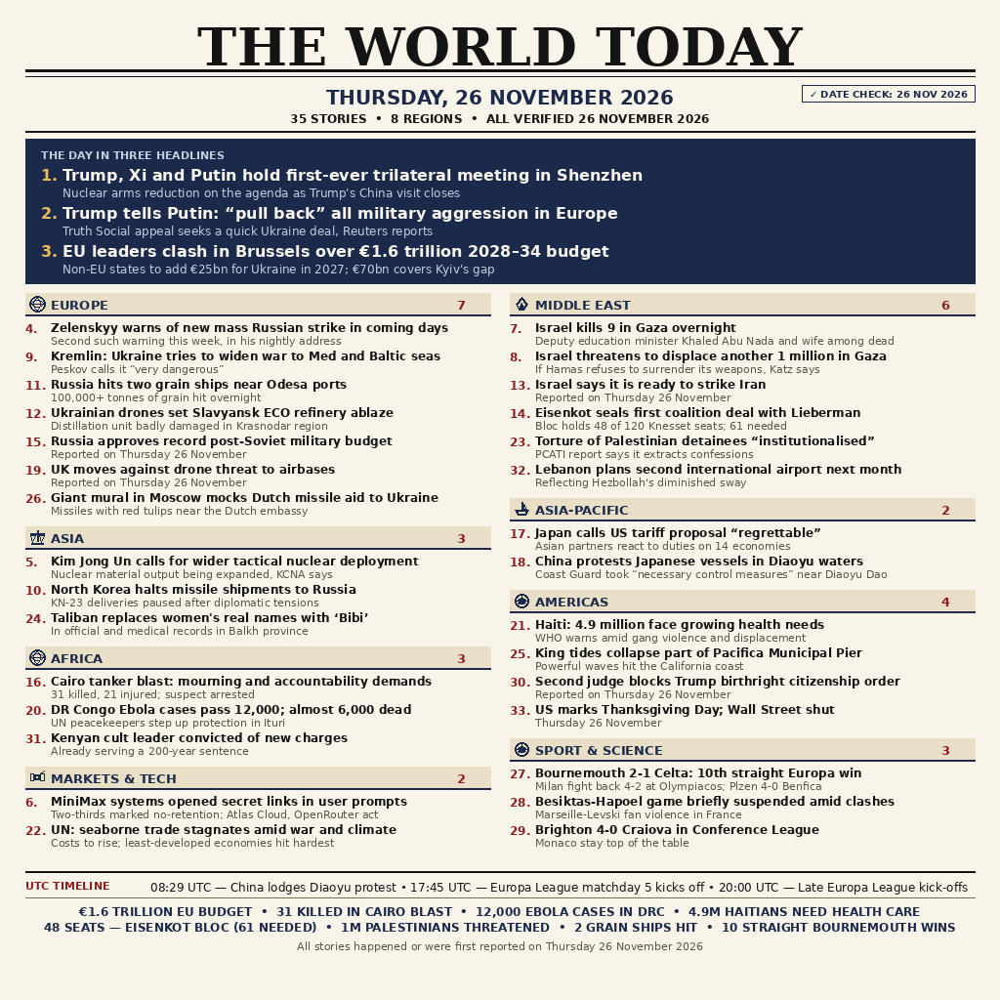

# The World Today — Thursday, 26 November 2026

A make.fun entry for **"Sum up 26 November's world news in one image"**
(`news-image-20261126`): one 1024×1024 newspaper front page summing up the
world news of Thursday 26 November 2026.

## What's on the page

- **35 stories across 8 regions** — Europe, Middle East, Asia, Asia-Pacific,
  Africa, Americas, Markets & Tech, and Sport & Science — every one of them
  happened, or was first reported, on Thursday 26 November 2026.
- **Three lead headlines**: the first-ever Trump–Xi–Putin trilateral meeting
  in Shenzhen; Trump's "pull back" appeal to Putin on Europe; and EU leaders
  clashing in Brussels over the €1.6 trillion 2028–34 budget.
- A **UTC timeline strip** (08:29, 17:45, 20:00 UTC), a **day-in-numbers**
  band, a date-check chip, and the verification line: *"All stories happened
  or were first reported on Thursday 26 November 2026"*.
- Drawn section icons (globe, scales, satellite, football, ship, flame)
  made only with PIL drawing primitives — no photos, no network.

## How it runs

`main.py` (Python 3.13, standard library only) copies the bundled
`entry.png` to `$MAKEFUN_OUTPUT_DIR/entry.png` (default `/output/entry.png`),
after validating the PNG magic bytes and the ≤ 1 MiB size limit. The image is
a fixed file, so the program is deterministic by construction: two runs write
byte-identical output.

`draw.py` (build-time only, requires Pillow) renders `entry.png` from scratch
with DejaVu fonts; two runs produce byte-identical PNGs.

## License

MIT — see [LICENSE](LICENSE).
